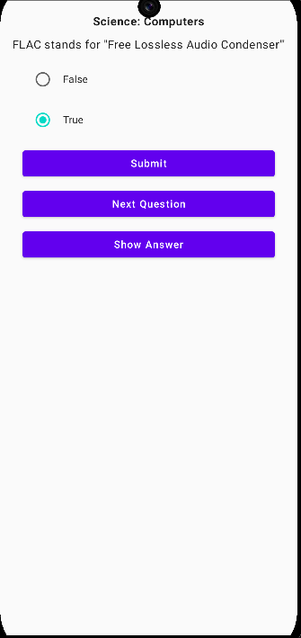
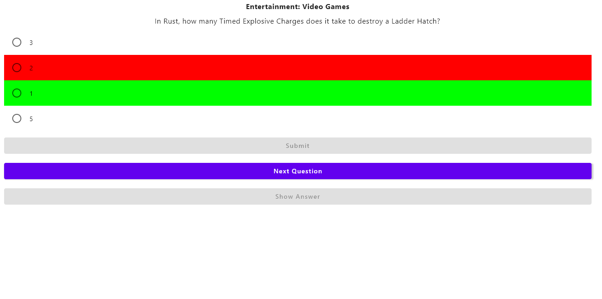

# KMP Trivia

A trivia game written once in Kotlin Multiplatform and Compose Multiplatform, running on Android, iOS, desktop (JVM)
and the web (Wasm). It fetches one question at a time from the [Open Trivia Database](https://opentdb.com/api_config.php)
with Ktor. Pick an answer and press Submit, or press Show Answer: the right answer turns green and a wrong pick red.
The API allows one request every five seconds; when the app hits that limit it says so and shows a Retry button.

The UI, view model and data code all live in `composeApp/src/commonMain`. The screen follows a small MVI pattern:
`QuestionAction` goes into `QuestionViewModel`, which publishes a `QuestionState`.




## Run

```sh
./gradlew :composeApp:run                          # desktop
./gradlew :composeApp:wasmJsBrowserDevelopmentRun  # web, in the browser
./gradlew :composeApp:installDebug                 # Android, on a connected device or emulator
```

For iOS, open `iosApp/iosApp.xcodeproj` in Xcode and run it.
